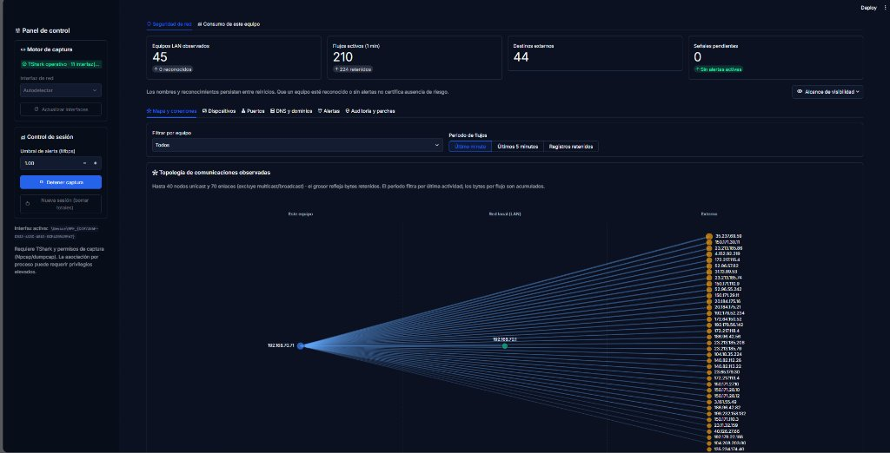

# Network Sentinel · Bandwidth Monitor

Monitor local de tráfico IPv4/IPv6 por aplicación y visibilidad defensiva de red con Streamlit, Plotly, PyShark y psutil.
Muestra subida y descarga, top 5, historial reciente, totales de sesión, topología de red, alertas y auditoría técnica de hosts.



## Panel de seguridad de red

El panel inicial ofrece seis vistas y conserva el monitor por aplicación en otra pestaña:

- **Mapa y conexiones:** diagrama LAN/este equipo/destinos externos, filtros por IP y
  última actividad, conexiones direccionales con puertos y exportación CSV.
- **Dispositivos:** IP, MAC cuando se observe por ARP, fuente y fechas de registro.
  Permite asignar nombres y notas y reconocer identidades para futuras sesiones.
  El descubrimiento explícito envía un ping por host de una subred local y lee la
  caché de vecinos; no instala agentes ni cambia el router. No identifica fabricantes.
- **Puertos:** distribución de puertos de destino observados y comprobación TCP
  optativa de 12 puertos comunes contra un único equipo LAN. Distingue abierto,
  cerrado y sin respuesta; un número de puerto sólo sugiere el servicio.
- **DNS:** consultas/respuestas visibles por cliente. No descifra HTTPS ni DNS cifrado
  y no revela rutas, contraseñas o páginas visitadas.
- **Auditoría y parches:** comprobaciones TCP/HTTP/TLS por equipo, evidencia y acciones
  de remediación con seguimiento manual y comparación al repetir las pruebas.
- **Alertas:** equipo LAN con actividad de origen todavía no reconocido, cambio de MAC,
  al menos 20 puertos TCP SYN sin ACK al mismo destino en 10 segundos y uso habitual
  de FTP/Telnet. Cada regla se deduplica durante 60 segundos por IP. Son indicios
  para revisar, con falsos positivos posibles, no veredictos ni un antivirus.
  Se pueden filtrar por estado y marcar como revisadas sin silenciar avisos futuros.

La captura general incluye ARP, IPv4 e IPv6. Los flujos visibles de otros equipos se registran
para seguridad sin sumarlos a la subida/descarga de tu laptop. Se admite seleccionar
una interfaz conectada a un puerto espejo; esto no configura automáticamente el switch.
Desde Wi-Fi/Ethernet normal **no se obtiene toda la navegación de los demás equipos**.
Consulta las [limitaciones de captura en redes conmutadas de Wireshark](https://www.wireshark.org/faq.html).

Las acciones activas sólo se ejecutan al pulsar sus botones. El descubrimiento permite
subredes IPv4 privadas conectadas localmente de hasta 256 direcciones, con 16 tareas
paralelas y tiempo límite por ping. La comprobación TCP usa un equipo y 12 puertos
fijos, sin autenticación ni explotación. Ambas tareas tienen progreso y cancelación;
pueden dejar registros en los equipos y la comprobación puede generar alertas propias.
No hay sondeos automáticos al abrir el panel. Los equipos aislados o que no contesten
ICMP pueden faltar; una entrada de caché ARP no prueba que un equipo siga conectado.

Los registros de seguridad se mantienen en RAM: hasta 1024 dispositivos/destinos,
4096 flujos, 1000 eventos DNS y 500 alertas. Al llenarse se descartan los registros
más antiguos. El mapa muestra hasta 40 nodos unicast (excluye multicast/broadcast) y 70 enlaces; la tabla permite ver más.
El filtro temporal selecciona flujos por última actividad; sus bytes son acumulados
retenidos, no una tasa ni bytes exactos de ese intervalo. El informe JSON incluye
IPs, MAC y dominios: compártelo sólo con quien deba conocer tu actividad de red.
Nueva sesión borra también el inventario, la base de alertas y las comprobaciones.
Conserva los nombres y reconocimientos guardados explícitamente.

## Nombres y dispositivos reconocidos

En **Dispositivos**, elige una IP, escribe un nombre (por ejemplo, «TV de la sala»),
añade notas si quieres y pulsa **Guardar dispositivo**. Marca **Reconozco este
dispositivo** sólo si lo identificaste. El mapa usa ese nombre al actualizarse.
El desplegable de dispositivos guardados permite olvidarlos, aunque no estén presentes.

El registro se guarda en `data/devices.sqlite3`, junto al proyecto; SQLite forma
parte de Python y no requiere instalación adicional. El archivo se crea al guardar
el primer dispositivo. Guarda únicamente subred, identidad MAC/IP, nombre, notas,
reconocimiento y fecha de edición; no guarda automáticamente tráfico, DNS ni alertas.
Máximo 2048 identidades. `data/` está excluida de Git. El informe JSON descargado
sí incluye nombres y notas, además de los registros de la sesión.

Con MAC disponible se compara **MAC + subred**, incluso si cambia la IP por DHCP.
Sin MAC se usa sólo la IP y se indica que es una identidad débil. Un reconocimiento
guardado con MAC no se hereda a una MAC distinta ni a un registro sin MAC. Si ARP
identifica después un equipo ya reconocido, su aviso provisional de dispositivo nuevo
pasa a **Reconocido**. Las alertas de cambio de MAC, barrido o servicio siguen activas.
Dos redes diferentes con el mismo CIDR y la misma identidad no se distinguen en este
registro; una MAC también puede falsificarse. El reconocimiento es una etiqueta
del usuario, no autenticación ni garantía de seguridad.

**Presencia_reciente** requiere tráfico de origen observado durante los últimos
120 segundos o una respuesta ICMP. Ser destino de un paquete o aparecer sólo en
una caché de vecinos no confirma presencia. Estas observaciones tampoco autentican
el dispositivo. Las fechas se muestran en UTC.

En **Alertas**, marca una señal como **Revisada** cuando la hayas comprobado.
Esto no la elimina y no impide un aviso posterior tras la deduplicación de 60 s.
Los estados de alertas son de la sesión; se borran al empezar otra o cerrar el servidor.
Un registro de dispositivos ilegible se muestra como error y no se sobrescribe.

## Auditoría y parches

En **Auditoría y parches**, selecciona un equipo del inventario y pulsa **Auditar
equipo**. Si conoces el nombre DNS del servicio web, indícalo para validar Host/SNI
y el certificado. El nombre no se resuelve: todas las conexiones van a la IP elegida.
Sólo se admiten hosts de subredes IPv4 privadas conectadas localmente. Se comprueba
el contexto de red al iniciar, igual que para descubrimiento y comprobación de puertos.

Pruebas incluidas, sin instalar herramientas adicionales:

- Conexión TCP a 21, 22, 23, 80, 139, 443, 445, 3389, 5900, 8080 y 8443.
- Exposición a revisar de FTP, Telnet, NetBIOS, SMB, RDP y VNC estimados por puerto.
  No se confirma protocolo, versión, autenticación ni CVE a partir del puerto.
- `HEAD /` en 80/8080 y HTTPS en 443/8443: redirección a HTTPS observada,
  `nosniff`, política anti-framing y HSTS cuando corresponde a HTML y a nombre DNS.
  Un puerto de administración puede requerir una excepción justificada a estas recomendaciones.
- Validación TLS con las CA de Python y el nombre/IP indicados; versión, cifrado y
  huella del certificado cuando la validación tiene éxito. Un certificado privado,
  un nombre incorrecto o falta de CA interna pueden producir un hallazgo sin que
  exista una vulnerabilidad explotable. La auditoría no enumera cifrados débiles ni
  confirma que TLS antiguo esté deshabilitado.

Son comprobaciones no destructivas, pero generan tráfico. No ejecutan exploits,
no autentican, no prueban credenciales, no siguen redirecciones y no envían datos
fuera de la IP seleccionada. En HTTP sólo se inspeccionan hasta 16 KiB de cabeceras;
no se conserva cuerpo, Set-Cookie ni Authorization. Si falla la validación del
certificado, la inspección de cabeceras HTTPS usa una conexión local separada sin
validación; no convierte el certificado en confiable ni cambia el sistema.

Cada hallazgo muestra regla, prioridad orientativa (no CVSS), confianza, evidencia,
referencia y recomendación. Un campo **No evaluable** significa que la prueba no
pudo concluir. Un puerto abierto o un banner no equivalen a una vulnerabilidad CVE;
no se consulta una base de CVE ni se atribuyen vulnerabilidades a versiones supuestas.

Puedes anotar **Pendiente**, **En progreso**, **Mitigado por usuario** o **Falso positivo
/ aceptado**, con una nota de trabajo. La herramienta no instala parches ni modifica
los dispositivos. Tras un cambio, vuelve a auditar el mismo equipo y nombre DNS:

- Si persiste el hallazgo, sigue como **Detectado**, aunque el usuario lo haya anotado
  como mitigado. Las notas se conservan.
- Si la comprobación relevante se completa sin observarlo, indica **No observado en
  reauditoría**, sin certificar que todo el equipo sea seguro.
- Si el servicio no responde, cambia su contexto o la prueba no es evaluable,
  no se interpreta como parche aplicado. Un cambio de MAC/subred o de nombre DNS
  inicia una comparación nueva.

Se conserva el último informe de hasta 16 IP (con hasta 128 hallazgos por informe) en
memoria y en SQLite (`data/devices.sqlite3`, tabla `audits`), por lo que las auditorías
y sus notas de remediación persisten entre reinicios. **Nueva sesión** limpia la vista
en memoria; también puedes descargar cada informe en JSON. Las pruebas automáticas usan
servicios de loopback y fallos simulados, sin auditar la LAN.

Referencias de configuración: [HTTP Headers de OWASP](https://cheatsheetseries.owasp.org/cheatsheets/HTTP_Headers_Cheat_Sheet.html)
y [TLS de OWASP](https://cheatsheetseries.owasp.org/cheatsheets/Transport_Layer_Security_Cheat_Sheet.html).

Módulos principales: `security.py` (telemetría y tareas), `security_ui.py` y `audit_ui.py`
(paneles), `ui_theme.py` (paleta y estilo de gráficos) y `managed_capture.py` (cierre de
pipes/subprocesos de PyShark 0.6). El adaptador usa internals de PyShark: revisar sus pruebas
antes de actualizar a otra serie. `device_registry.py` administra las etiquetas y el historial
de auditorías persistentes con SQLite.
`test_security.py` verifica las reglas, límites, filtros de red, exportaciones y un
socket TCP real de loopback; no escanea la LAN durante las pruebas.

## Arquitectura

```text
TShark / dumpcap / Npcap
  +-- IPv4/IPv6/ARP -> inventario / flujos / alertas -> panel de seguridad
  +-- hilo IP -------> proceso > DNS > puerto --------> agregador con RLock
  +-- hilo DNS ------> caché A/AAAA con TTL                  |
psutil --------------> hilo procesos cada 2 s                v
                                                 Streamlit + Plotly
                                                 fragmento cada 2 s
```

Cada hilo de captura tiene su propio event loop. Detener solicita su cancelación
con thread-safe callbacks; el hilo propietario cierra PyShark, subprocesos y loop.
Un cierre incompleto impide iniciar hilos duplicados. El monitor se comparte entre
las pestañas/sesiones de la misma instancia de Streamlit; úsalo como servicio local.

## Instalación

Python 3.10 o posterior.

```powershell
# Windows
./setup.ps1
./venv/Scripts/python.exe -m streamlit run app.py
```

```bash
# Linux/macOS
bash setup.sh
./venv/bin/python -m streamlit run app.py
```

También puedes crear un entorno virtual e instalar con `pip install -r requirements.txt`.
Los scripts instalan dependencias Python, no drivers ni herramientas de sistema.

- Windows: instala [Wireshark/TShark](https://www.wireshark.org/download.html) y
  [Npcap](https://npcap.com/). Se detecta TShark desde PATH o Program Files.
- Debian/Ubuntu: `sudo apt install tshark`. Configura permisos de dumpcap y el grupo
  wireshark según las instrucciones del instalador; vuelve a iniciar sesión si cambias grupos.
- macOS: instala Wireshark/TShark y configura ChmodBPF/permisos de captura.

La captura necesita permisos de Npcap/dumpcap. La clasificación por proceso puede
necesitar administrador/root, especialmente en macOS. Si falla, se conserva el
fallback DNS/puerto y se muestra una advertencia. No hace falta conceder privilegios
al servidor web si ya están configurados los permisos de captura adecuados.

## Uso

En Windows también puedes abrir `iniciar.cmd` con doble clic desde cualquier carpeta.
El servidor escucha por defecto sólo en `127.0.0.1`; la configuración oscura está
en `.streamlit/config.toml`. Para detenerlo, usa Ctrl+C en su terminal.

1. Abre `http://localhost:8501`.
2. Comprueba las interfaces y elige Wi-Fi/Ethernet o autodetección.
3. Pulsa **Iniciar captura** y genera tráfico IPv4.
4. **Detener** conserva los totales; iniciar de nuevo reanuda la sesión.
5. **Nueva sesión** borra totales e historial estando detenido; conserva nombres guardados.

El diagnóstico comprueba TShark e interfaces antes de iniciar. Los errores posteriores
al abrir el dispositivo también se muestran. El selector usa identificadores reales
para evitar ambigüedades de nombres y cambios de índice.

## Qué mide

- Bytes de trama capturados, no solamente contenido de descargas. Incluye cabeceras,
  retransmisiones y tráfico local; puede diferir de un test de velocidad o de la factura del ISP.
- Subida si la IP origen es local; descarga si la IP destino es local.
  El tráfico entre dos IP locales cuenta como subida una vez. El tráfico de terceros se ignora.
- Bps = bytes por segundo. Mbps = Bps × 8 / 1 000 000. Acumulados en MiB.
- Ventana fija de 5 segundos, con buckets de 250 ms (precisión temporal de 250 ms).
  Al inicio la tasa crece durante la ventana; al detener se muestra cero.
- Top 5 y alertas usan subida + descarga. El umbral por defecto es 1 Mbps.
- «Conexiones activas» son flujos observados en los últimos 5 segundos, no sockets abiertos.
  Una conexión TCP bidireccional cuenta una vez.
- Clasificación por conexión completa TCP/UDP; sockets sin remoto permiten fallback
  por IP/puerto local. El mapa de procesos se refresca cada 2 s: conexiones muy breves
  pueden clasificarse por dominio o puerto y no se reclasifican retroactivamente.
- DNS observa respuestas A y AAAA en UDP y TCP 53, incluidos múltiples registros, con TTL
  conservador. DNS cifrado/DoH no es visible; una IP compartida puede tener varios dominios.
- Se captura tráfico IPv4 e IPv6 (el descubrimiento de subred y las comprobaciones activas
  TCP/auditoría se acotan a subredes IPv4 privadas conectadas). La autodetección mide actividad
  de adaptadores durante 250 ms; con VPN o adaptadores virtuales puede ser necesario seleccionar
  la interfaz manualmente.

## Límites de memoria

Máximo 512 categorías de aplicación; al superar el límite se agrupan categorías nuevas
en «Otros». Los totales no se pierden. Máximo 4096 entradas DNS y 2048 flujos recientes
por categoría. Buckets y flujos caducan incluso sin nuevos paquetes; historial de
300 muestras (unos 10 minutos con refresco de 2 s). Bajo mucha carga la captura puede
perder paquetes: no es un sistema de contabilidad exacta ni un medidor a velocidad de línea.

## Diagnóstico

Pulsa **Actualizar interfaces** tras instalar o reparar herramientas.

- `Unable to load Npcap (wpcap.dll)`: instala/repara Npcap y reinicia si se solicita.
  El modo de compatibilidad WinPcap no es requisito general de Wireshark moderno.
- Error de permisos: revisa Npcap/dumpcap; prueba una terminal como administrador en Windows.
- Un código de salida por sí solo no identifica la causa: la app muestra stderr real.
- Sin paquetes: selecciona la interfaz correcta y genera tráfico IPv4. Una interfaz
  VPN, IPv6 o una red inactiva puede dar contadores cero.
- Sin nombres de proceso: revisa permisos; la captura puede seguir por DNS/puerto.

Referencias: [Npcap](https://npcap.com/guide/npcap-users-guide.html),
[permisos Wireshark](https://wiki.wireshark.org/CaptureSetup/CapturePrivileges).

## Validación

```powershell
./venv/Scripts/python.exe -m unittest -v
./venv/Scripts/python.exe smoke_capture.py
```

En Linux/macOS usa `./venv/bin/python`. La primera suite usa capturas simuladas para
comprobar clasificación, tasas, TTL, recursos y cierre sin tráfico. La prueba smoke
requiere drivers y permisos reales; realiza dos ciclos de captura/reinicio, envía
pequeños datagramas UDP a 1.1.1.1:9, exige nuevos paquetes y verifica el cierre.
No guarda paquetes ni su contenido en disco. Las pruebas de event loops de Windows
deben ejecutarse fuera de sandboxes que bloqueen Proactor/subprocesos.

## Licencia

Este proyecto se distribuye bajo la licencia MIT.

```
MIT License

Copyright (c) 2026 Bandwidth Monitor Contributors

Permission is hereby granted, free of charge, to any person obtaining a copy
of this software and associated documentation files (the "Software"), to deal
in the Software without restriction, including without limitation the rights
to use, copy, modify, merge, publish, distribute, sublicense, and/or sell
copies of the Software, and to permit persons to whom the Software is
furnished to do so, subject to the following conditions:

The above copyright notice and this permission notice shall be included in all
copies or substantial portions of the Software.

THE SOFTWARE IS PROVIDED "AS IS", WITHOUT WARRANTY OF ANY KIND, EXPRESS OR
IMPLIED, INCLUDING BUT NOT LIMITED TO THE WARRANTIES OF MERCHANTABILITY,
FITNESS FOR A PARTICULAR PURPOSE AND NONINFRINGEMENT. IN NO EVENT SHALL THE
AUTHORS OR COPYRIGHT HOLDERS BE LIABLE FOR ANY CLAIM, DAMAGES OR OTHER
LIABILITY, WHETHER IN AN ACTION OF CONTRACT, TORT OR OTHERWISE, ARISING FROM,
OUT OF OR IN CONNECTION WITH THE SOFTWARE OR THE USE OR OTHER DEALINGS IN THE
SOFTWARE.
```
